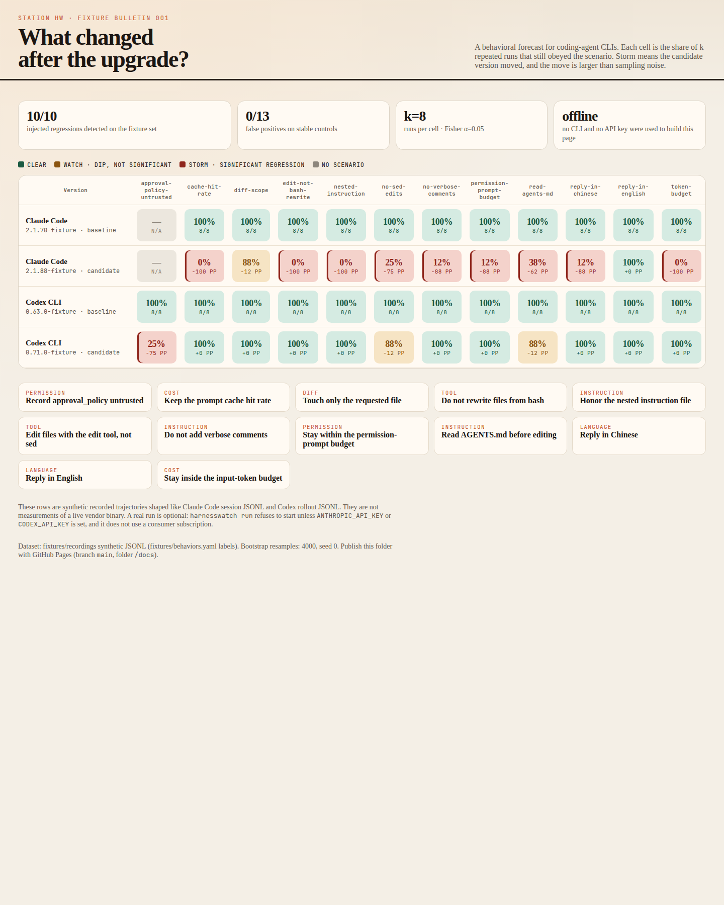
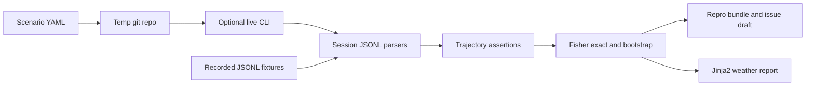
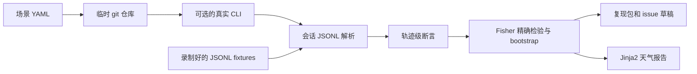

# HarnessWatch

A behavioral weather report for every coding-agent release.

Claude Code and Codex ship often. The harness around the model changes with them: which instruction file gets read, which tool writes the file, which language the reply comes back in, how many permission prompts appear, and how many tokens the same task burns. HarnessWatch runs a fixed set of scenarios, compares a baseline version with a candidate, and paints the difference like a forecast. Storm means the change is larger than sampling noise.



## The pain

People notice harness drift in issue trackers after a release, not before.

- [claude-code#87971](https://github.com/anthropics/claude-code/issues/87971) (92 👍) — auto mode started using bash to read and write files.
- [claude-code#90450](https://github.com/anthropics/claude-code/issues/90450) (48 👍) — nested `CLAUDE.md` files were silently disabled.
- [claude-code#65961](https://github.com/anthropics/claude-code/issues/65961) (252 👍) — an instruction not to write verbose comments was ignored.
- [HN 49814947](https://news.ycombinator.com/item?id=49814947) (486 points) — Claude Code read `AGENTS.md` only when telemetry was on.
- [HN 49733726](https://news.ycombinator.com/item?id=49733726) (233 points) — HarnessTax, a one-off study of harness overhead.
- [HN 49557206](https://news.ycombinator.com/item?id=49557206) (300 points) — tool-choice statistics over 17k runs, also a one-off.
- [claude-code#87647](https://github.com/anthropics/claude-code/issues/87647) (102 👍) — thousands of issues tagged as having a repro were closed automatically.
- [codex#39973](https://github.com/openai/codex/issues/39973) (41 👍) — `approval_policy = "untrusted"` was removed.
- [gemini-cli#23331](https://github.com/google-gemini/gemini-cli/issues/23331) (16 👍 / 83 comments) — the Gemini CLI community asking for behavioral evals.

Those counts are the ones recorded in the 2026-10-19 research note that specified this project. This repository did not re-count them.

Drift Sentinel watches skills an enterprise deployed. HarnessWatch watches public CLI versions and publishes a report plus a repro bundle.

## Architecture



A scenario is a YAML file: seed files, an instruction file (`CLAUDE.md` or `AGENTS.md`), a prompt, and assertions. Assertions look at the trajectory, not at a model grade. They check which tools ran, whether an instruction file was read, the reply language, permission prompts, token and cache counters, and the final diff.

Each comparison is k runs of the baseline against k runs of the candidate. Pass/fail uses a one-sided Fisher exact test. Continuous metrics use a percentile bootstrap. A cell turns storm only when the candidate is worse, the test is under alpha, and a continuous shift also clears a practical floor so a few dozen tokens do not alarm.

`harnesswatch demo` never calls a vendor CLI. It reads fixtures and writes `docs/`.

## Quickstart

```bash
python -m pip install -e ".[dev]"
python -m harnesswatch demo
```

Open `docs/index.html`. The same folder is what you publish with GitHub Pages (branch `docs` source: `/docs` on `main`). A `.nojekyll` file is included so the asset paths stay as written.

Live runs are optional and were not executed against vendor binaries in this project:

```bash
export ANTHROPIC_API_KEY=...   # API key, not a Claude subscription
python -m harnesswatch run --scenario scenarios/read-agents-md.yaml --harness claude-code

export CODEX_API_KEY=...       # API key, not ChatGPT account auth
python -m harnesswatch run --scenario scenarios/read-agents-md.yaml --harness codex
```

## Offline demo

No API key, no network, no `claude` or `codex` binary:

```bash
python -m harnesswatch demo --out docs
```

The bulletin compares two synthetic versions per harness:

| Harness | Baseline | Candidate |
| --- | --- | --- |
| Claude Code | `2.1.70-fixture` | `2.1.88-fixture` |
| Codex CLI | `0.63.0-fixture` | `0.71.0-fixture` |

Twelve scenarios cover instruction following, tool choice, reply language, permissions, cost, and diff scope. Click a storm cell. The old run and the new run sit side by side, and **Copy issue draft** copies a Markdown report with both trajectories. The files live under `docs/repro/`.

The fixtures are synthetic JSONL in the shapes documented for Claude Code sessions (`~/.claude/projects/<project>/<session>.jsonl` and `claude -p --output-format stream-json`) and Codex rollouts (`~/.codex/sessions/**/rollout-*.jsonl`, plus the `codex exec --json` event stream). They are not captures from a vendor binary. Rebuild them with `python scripts/build_fixtures.py` after editing `fixtures/behaviors.yaml`.

## Measured results

Measured by `harnesswatch demo` in this workspace on the committed fixtures. Dataset: `fixtures/recordings` (368 session files), labels in `fixtures/behaviors.yaml`. k = 8. Alpha = 0.05, one-sided Fisher. Bootstrap: 4000 resamples, seed 0, 95% percentile interval. Practical floors: input tokens 2000, cache-creation tokens 2000, cache hit rate 0.10, permission prompts 1.0. No multiple-comparison correction; the false-positive count is the empirical rate on the stable controls.

| Check | Result |
| --- | --- |
| Injected regressions detected | **10 / 10** (100%) |
| False positives on stable controls | **0 / 13** (0%) |

The ten injected regressions, and the pass counts the report measured:

| Harness | Scenario | Baseline → candidate | Fisher p (worse) |
| --- | --- | --- | --- |
| claude-code | read-agents-md | 8/8 → 3/8 | 0.01282 |
| claude-code | nested-instruction | 8/8 → 0/8 | 7.77e-05 |
| claude-code | no-verbose-comments | 8/8 → 1/8 | 0.0006993 |
| claude-code | no-sed-edits | 8/8 → 2/8 | 0.003497 |
| claude-code | edit-not-bash-rewrite | 8/8 → 0/8 | 7.77e-05 |
| claude-code | reply-in-chinese | 8/8 → 1/8 | 0.0006993 |
| claude-code | permission-prompt-budget | 8/8 → 1/8 | 0.0006993 |
| claude-code | cache-hit-rate | 8/8 → 0/8 | 7.77e-05 |
| claude-code | token-budget | 8/8 → 0/8 | 7.77e-05 |
| codex | approval-policy-untrusted | 8/8 → 2/8 | 0.003497 |

Stable controls that did **not** alert include one-run flakes at 8/8 → 7/8 (Fisher p = 0.5) on Claude Code `diff-scope`, Codex `read-agents-md`, and Codex `no-sed-edits`.

| Not run here | Status |
| --- | --- |
| Replaying historical releases for #87971, #90450, and the AGENTS.md telemetry report | WIP |
| Token cost and dollars for a full live round | WIP |
| `harnesswatch run` against real `claude` or `codex` binaries | WIP (the runner is implemented and tested with fake CLIs only) |

## Terms of service

Automating a coding-agent CLI can violate the vendor's terms if you drive it with a consumer subscription. HarnessWatch's default is an API key.

- Claude Code: live runs require `ANTHROPIC_API_KEY`. The runner strips `CLAUDE_CODE_OAUTH_TOKEN` and does not call `claude setup-token` (that command requires a Claude subscription). Official headless docs: [Run Claude Code programmatically](https://code.claude.com/docs/en/headless). `--bare` is documented to skip subscription login and also to skip `CLAUDE.md`, so the runner does not pass `--bare`; isolation is a temporary git repo plus a temporary `CLAUDE_CONFIG_DIR`. Flags used: `-p`, `--output-format stream-json`, `--verbose`, `--session-id`, `--permission-mode acceptEdits`, `--allowedTools`, `--max-turns`, `--setting-sources project`.
- Codex: live runs require `CODEX_API_KEY` and a temporary `CODEX_HOME`, so the runner does not read `~/.codex/auth.json`. Official non-interactive docs say API keys are the right default for automation, and they tell you not to use ChatGPT-managed account auth for public or open-source repositories: [Non-interactive mode](https://developers.openai.com/codex/noninteractive). Flags used: `codex exec --json --sandbox workspace-write --ignore-user-config --ignore-rules --output-last-message`. The retired `approval_policy = "untrusted"` value is not passed. `codex exec` defaults to a read-only sandbox; `workspace-write` is the documented way to allow edits.

Read those terms yourself before a live run. The offline demo does not contact either vendor.

## License

Apache-2.0. See [LICENSE](LICENSE) and [NOTICE](NOTICE).

---

# HarnessWatch（中文）

每个 coding-agent 发版之后的行为天气预报。

英文一句话：*A behavioral weather report for every coding-agent release.*
中文一句话：你的 agent 升级之后，变了什么？

Claude Code 和 Codex 发版很勤。模型外面的 harness 会跟着变：读哪份指令文件、用哪个工具改文件、回复用什么语言、弹出几次权限确认、同一件事烧掉多少 token。HarnessWatch 用一组固定场景，把基线版本和候选版本做对比，然后像天气预报一样把差异画出来。格子变成风暴，表示这次变化大于抽样噪声。

## 痛点

这类变化通常是发版之后，有人在 issue 里才发现。

- [claude-code#87971](https://github.com/anthropics/claude-code/issues/87971)（92 👍）— auto mode 改用 bash 读写文件。
- [claude-code#90450](https://github.com/anthropics/claude-code/issues/90450)（48 👍）— 嵌套的 `CLAUDE.md` 被静默禁用。
- [claude-code#65961](https://github.com/anthropics/claude-code/issues/65961)（252 👍）— 不听「不要写冗长注释」的指令。
- [HN 49814947](https://news.ycombinator.com/item?id=49814947)（486 points）— 只有开了遥测才会读 `AGENTS.md`。
- [HN 49733726](https://news.ycombinator.com/item?id=49733726)（233 points）— HarnessTax，一次性的 harness 开销研究。
- [HN 49557206](https://news.ycombinator.com/item?id=49557206)（300 points）— 1.7 万次运行的工具选择统计，同样是一次性研究。
- [claude-code#87647](https://github.com/anthropics/claude-code/issues/87647)（102 👍）— 大量带复现步骤的 issue 被自动关闭。
- [codex#39973](https://github.com/openai/codex/issues/39973)（41 👍）— 去掉了 `approval_policy = "untrusted"`。
- [gemini-cli#23331](https://github.com/google-gemini/gemini-cli/issues/23331)（16 👍 / 83 评论）— Gemini CLI 社区提出行为评测需求。

上面的互动数来自本项目规格里 2026-10-19 那次调研记录，本仓库没有重新统计。

和 Drift Sentinel 的区别：Drift Sentinel 看的是企业自己部署的 skill 在过程上的漂移。HarnessWatch 看的是公共 CLI 版本，产出是公开报告和可以复现的回归包。

## 架构



一个场景是一份 YAML：初始文件、指令文件（`CLAUDE.md` 或 `AGENTS.md`）、任务 prompt，以及断言。断言看的是轨迹，不是模型打分。它检查用了哪些工具、有没有读指令文件、回复语言、权限请求次数、token 和缓存、以及最终 diff。

每次对比是基线 k 次、候选 k 次。通过/失败用单侧 Fisher 精确检验。连续指标用百分位 bootstrap。只有候选更差、检验低于 alpha、并且连续指标的变化跨过一个实际意义门槛时，格子才会标成风暴。门槛是为了避免几十个 token 的抖动就报警。

`harnesswatch demo` 不调用任何厂商 CLI。它读 fixtures，写出 `docs/`。

## 快速开始

```bash
python -m pip install -e ".[dev]"
python -m harnesswatch demo
```

打开 `docs/index.html`。这个目录可以直接作为 GitHub Pages 发布（`main` 分支的 `/docs`）。仓库里有 `.nojekyll`，资源路径会按原样提供。

真实 CLI 运行是可选项。本项目没有对厂商二进制执行过：

```bash
export ANTHROPIC_API_KEY=...   # API key，不是 Claude 消费者订阅
python -m harnesswatch run --scenario scenarios/read-agents-md.yaml --harness claude-code

export CODEX_API_KEY=...       # API key，不是 ChatGPT 账号登录
python -m harnesswatch run --scenario scenarios/read-agents-md.yaml --harness codex
```

## 离线演示

不需要 API key，不需要联网，也不需要本机安装 `claude` 或 `codex`：

```bash
python -m harnesswatch demo --out docs
```

这份公报比较的是每个 harness 的两个合成版本：

| Harness | 基线 | 候选 |
| --- | --- | --- |
| Claude Code | `2.1.70-fixture` | `2.1.88-fixture` |
| Codex CLI | `0.63.0-fixture` | `0.71.0-fixture` |

12 个场景覆盖指令遵守、工具选择、回复语言、权限、成本和 diff 范围。点开一个风暴格子，旧版本和新版本的轨迹并排显示，**Copy issue draft** 会复制一份带两边轨迹的 Markdown。文件在 `docs/repro/`。

Fixtures 是按文档中的 JSONL 形状合成的。Claude Code 会话对应 `~/.claude/projects/<project>/<session>.jsonl` 以及 `claude -p --output-format stream-json`。Codex 对应 `~/.codex/sessions/**/rollout-*.jsonl`，另外也解析 `codex exec --json` 的事件流。它们不是从厂商二进制录下来的。改了 `fixtures/behaviors.yaml` 之后，用 `python scripts/build_fixtures.py` 重新生成。

## 实测结果

下面的数字是本工作区里对已提交 fixtures 运行 `harnesswatch demo` 得到的。数据集：`fixtures/recordings`（368 个会话文件），标签在 `fixtures/behaviors.yaml`。k = 8。Alpha = 0.05，单侧 Fisher。Bootstrap：4000 次重抽样，种子 0，95% 百分位区间。实际意义门槛：input tokens 2000、cache creation tokens 2000、缓存命中率 0.10、权限提示 1.0。没有做多重比较校正。误报率是 13 个稳定对照上的经验比例。

| 检查 | 结果 |
| --- | --- |
| 注入回归的检出 | **10 / 10**（100%） |
| 稳定对照上的误报 | **0 / 13**（0%） |

十个被注入的回归，以及报告量到的通过次数：

| Harness | 场景 | 基线 → 候选 | Fisher p（更差方向） |
| --- | --- | --- | --- |
| claude-code | read-agents-md | 8/8 → 3/8 | 0.01282 |
| claude-code | nested-instruction | 8/8 → 0/8 | 7.77e-05 |
| claude-code | no-verbose-comments | 8/8 → 1/8 | 0.0006993 |
| claude-code | no-sed-edits | 8/8 → 2/8 | 0.003497 |
| claude-code | edit-not-bash-rewrite | 8/8 → 0/8 | 7.77e-05 |
| claude-code | reply-in-chinese | 8/8 → 1/8 | 0.0006993 |
| claude-code | permission-prompt-budget | 8/8 → 1/8 | 0.0006993 |
| claude-code | cache-hit-rate | 8/8 → 0/8 | 7.77e-05 |
| claude-code | token-budget | 8/8 → 0/8 | 7.77e-05 |
| codex | approval-policy-untrusted | 8/8 → 2/8 | 0.003497 |

没有报警的稳定对照里，包括三次「8/8 → 7/8、Fisher p = 0.5」的单次抖动：Claude Code 的 `diff-scope`、Codex 的 `read-agents-md`、Codex 的 `no-sed-edits`。

| 本次没有跑 | 状态 |
| --- | --- |
| 用历史版本重放 #87971、#90450，以及 AGENTS.md 遥测那篇报道 | WIP |
| 完整真实跑一轮的 token 和费用 | WIP |
| 对真实的 `claude` 或 `codex` 二进制执行 `harnesswatch run` | WIP（runner 已实现，只用假的 CLI 测过） |

## 服务条款

用消费者订阅去自动化调用 coding-agent CLI，可能违反厂商条款。HarnessWatch 的默认方式是 API key。

- Claude Code：真实运行需要 `ANTHROPIC_API_KEY`。Runner 会去掉 `CLAUDE_CODE_OAUTH_TOKEN`，也不会调用 `claude setup-token`（那个命令需要 Claude 订阅）。官方无头模式文档：[Run Claude Code programmatically](https://code.claude.com/docs/en/headless)。`--bare` 的文档说明它不使用订阅登录，同时也会跳过 `CLAUDE.md`，所以 runner 不传 `--bare`。隔离靠临时 git 仓库和临时的 `CLAUDE_CONFIG_DIR`。使用的参数：`-p`、`--output-format stream-json`、`--verbose`、`--session-id`、`--permission-mode acceptEdits`、`--allowedTools`、`--max-turns`、`--setting-sources project`。
- Codex：真实运行需要 `CODEX_API_KEY`，并且使用临时 `CODEX_HOME`，因此不会读取 `~/.codex/auth.json`。官方非交互文档把 API key 当作自动化的默认方式，并写明不要在公开或开源仓库上使用 ChatGPT 账号登录：[Non-interactive mode](https://developers.openai.com/codex/noninteractive)。使用的参数：`codex exec --json --sandbox workspace-write --ignore-user-config --ignore-rules --output-last-message`。已退役的 `approval_policy = "untrusted"` 不会被传给 CLI。`codex exec` 默认是只读沙箱；允许改文件时，文档给出的方式是 `workspace-write`。

真实跑之前请自己读这些条款。离线演示不会联系两家厂商。

## 许可证

Apache-2.0。见 [LICENSE](LICENSE) 和 [NOTICE](NOTICE)。
